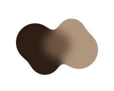

  

  

  
  
  
  

  hey! i'm an IT student. i build software at every level and work in
  cybersecurity and AI, then write the tests and checks that keep it honest.
  i care about code that works in production, not in tutorials.

  my goal is simple: build things people actually want and will really use.
  i want my work to help people, keep them safe and secure, and make everyday
  life a bit easier.

  open for freelance work

---

  
  
  
  
  
  
  
  

